# AeroGraph

<p align="center">
  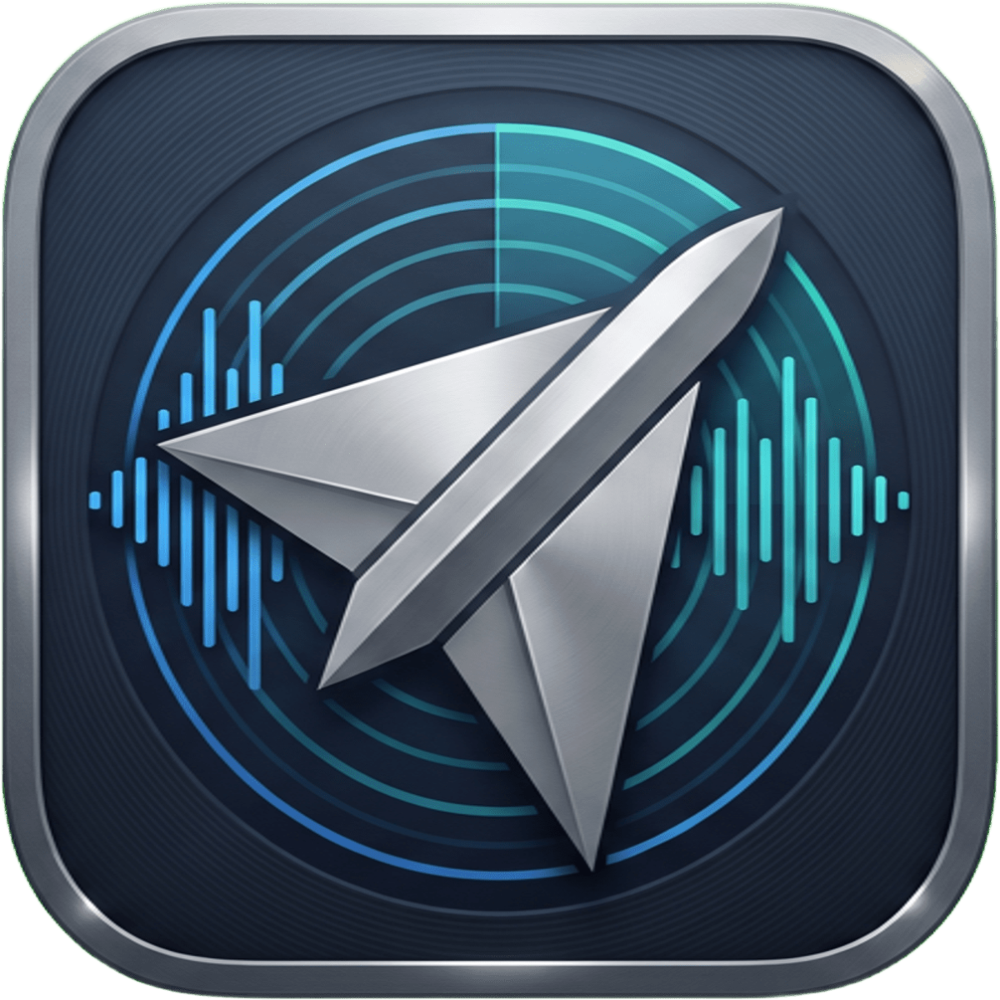
</p>

<p align="center">
  <strong>Next-Generation Standalone Kneeboard Generator & Real-Time Crew Chief Voice Engine for Falcon BMS</strong>
</p>

<p align="center">
  <a href="https://github.com/yagiziskirik/AeroGraph/releases"></a>
  <a href="LICENSE"></a>
  
  
  
</p>

---

## 📖 Table of Contents

- [Overview](#-overview)
- [Mission Showcase & Visual Gallery](#-mission-showcase--visual-gallery)
- [Design Philosophy & Origins](#-design-philosophy--origins)
- [Key Capabilities & Technical Specifications](#-key-capabilities--technical-specifications)
- [Detailed Performance Optimizations & SAPI Compaction](#-detailed-performance-optimizations--sapi-compaction)
- [Tested & Verified Versions](#-tested--verified-versions)
- [Setup & First-Time Configuration Guide](#-setup--first-time-configuration-guide)
- [Kneeboard Configuration (`kneeboards.json`)](#-kneeboard-configuration-kneeboardsjson)
- [T.O. 1F-16 POH Custom Notes & Scratchpad Guide](#-to-1f-16-poh-custom-notes--scratchpad-guide)
- [Crew Chief & Voice Commands Reference](#-crew-chief--voice-commands-reference)
- [System Tray Controls](#-system-tray-controls)
- [What AeroGraph Is NOT Replacing](#-what-aerograph-is-not-replacing)
- [Limitations & Operational Caveats](#-limitations--operational-caveats)
- [Frequently Asked Questions (FAQ) & Troubleshooting](#-frequently-asked-questions-faq--troubleshooting)
- [Installation & Uninstallation](#-installation--uninstallation)
- [Building from Source](#-building-from-source)
- [Community Credits & License](#-community-credits--license)

---

## ✈️ Overview

**AeroGraph** is a high-performance, standalone Windows application engineered in pure Rust for **Falcon BMS 4.38**. It unites two vital simulation capabilities into a single, lightweight background utility:

1. **Automated Kneeboard Generator & Live Briefing Watcher**: 
   A multi-threaded pipeline that detects mission briefings and dynamically renders pixel-calibrated, high-contrast, VR-optimized kneeboards (Package Roster, Comms Ladder, Steerpoints, Weather, 16k SkyVector Route & Combat Area Maps, Dynamic Airfield Ground Taxi Diagrams, ILS Approach Plates, and T.O. 1F-16 POH Flight Reference Cards). Texture injection into Falcon BMS 3D cockpit files (`7982.dds` through `7997.dds`) executes in **under 1.5 seconds**, while the entire end-to-end cycle; from briefing file detection to HTML rendering, map cropping, and texture injection, typically finishes in **under 10 seconds**.
2. **Crew Chief & Cockpit Voice Engine**: 
   A speech-recognition copilot and ground crew engine powered by the Microsoft Speech API (SAPI), DirectInput 8 HOTAS hardware axis and button sampling, and FoxVox `.fvx` profiles. Includes state-machine tracking (e.g. MPO kick check validation, wheel chocks, external air/power, engine start sequences) and low-latency audio cue feedback.

---

## 📸 Mission Showcase & Visual Gallery

All kneeboard pages are natively rendered at **1024×1554 resolution**, calibrated for the Falcon BMS F-16 physical cockpit kneeboard layout and tuned with a daylight `#FAFAF8` background for sharp readability across both 2D monitors and high-resolution VR headsets (Quest 3, Reverb G2, Pimax Crystal).

### In-Cockpit Flight Impressions

| Package Roster & Steerpoints (Wide Cockpit View) | BVR Combat Timelines & Theater Route Map |
| :---: | :---: |
| 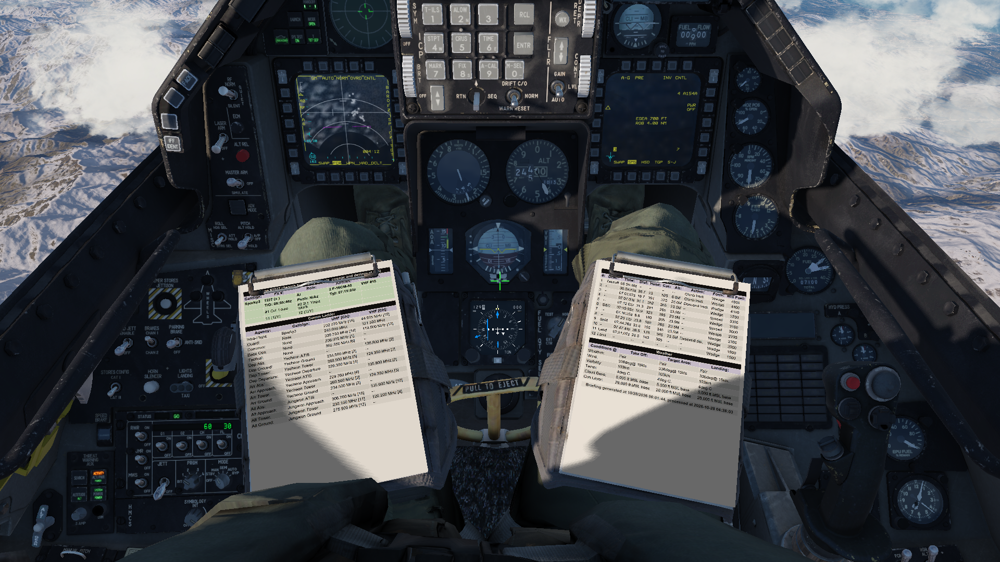 | 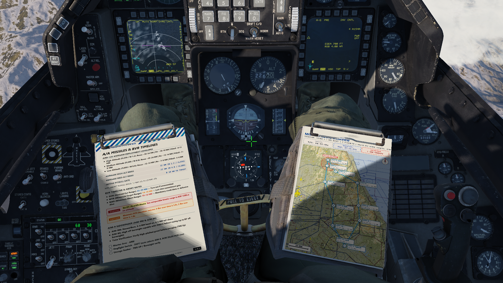 |
| *Left: Package Flight Calls, Tail Numbers & Comm Ladder (`briefing_roster`).<br />Right: Full Steerpoint Navigation Table, Fuel & Weather (`briefing_steerpoints`).* | *Left: T.O. 1F-16 A/A Missiles & BVR Employment Timelines Scratchpad (`notes`).<br />Right: 16k SkyVector Theater Route with Flight Polyline & Threat Rings (`mission_route`).* |

| SEAD ALIC Codes & Dynamic Departure Taxi Chart | Engine Start Checklist & Flameout Emergency Procedure |
| :---: | :---: |
| 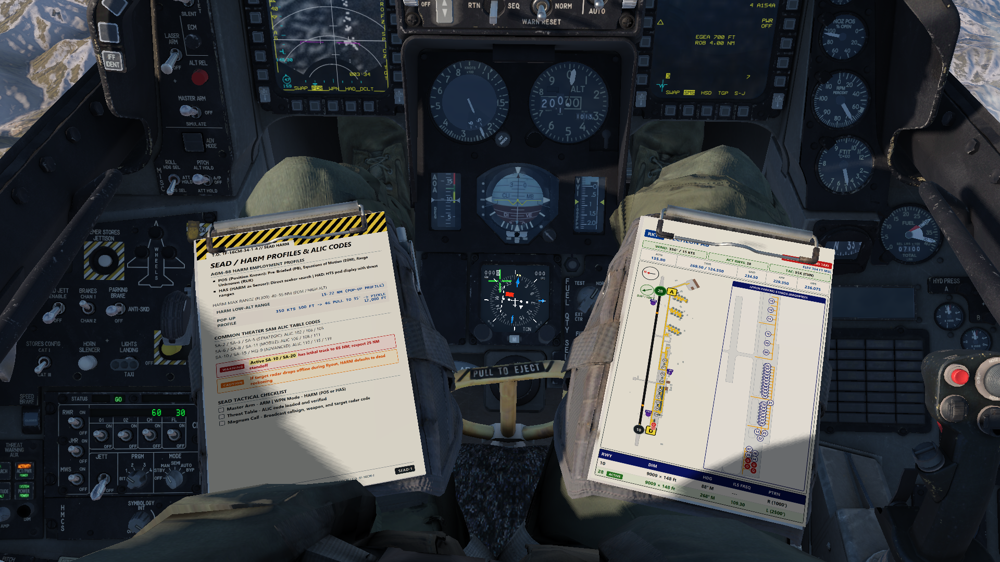 | 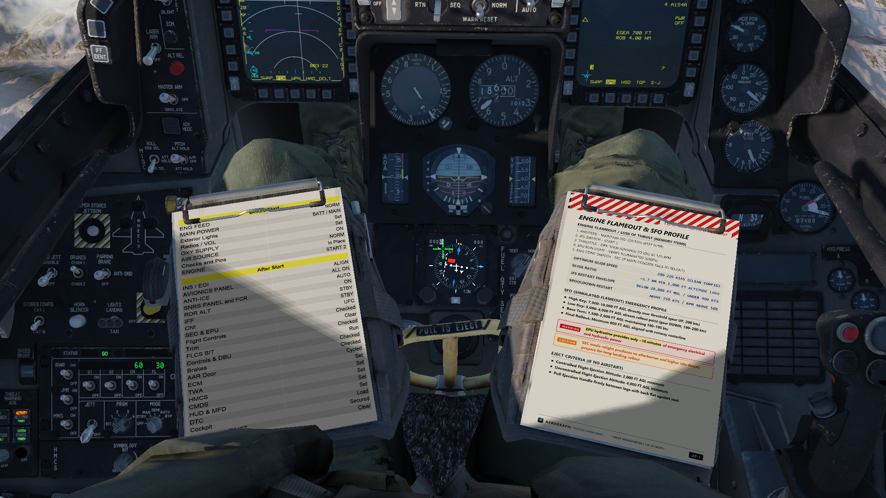 |
| *Left: T.O. 1F-16 SEAD / HARM Profiles & ALIC Codes Scratchpad (`notes`).<br />Right: Dynamic Departure Taxi Chart with Active Runway 28 & Calculated Wind Arrow (`dep_taxi`).* | *Left: Standard F-16 Before Start & After Start Cockpit Flow Checklist (`custom_html`).<br />Right: T.O. 1F-16 Engine Flameout & SFO Profile Emergency Procedures (`notes`).* |

### High-Resolution Page Templates

| Package Roster & Comm Ladder | Steerpoint Navigation & Weather |
| :---: | :---: |
| 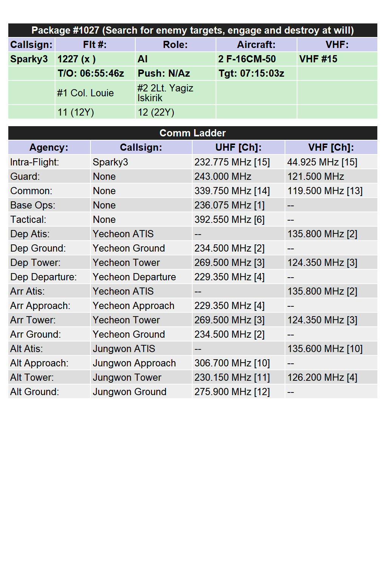 | 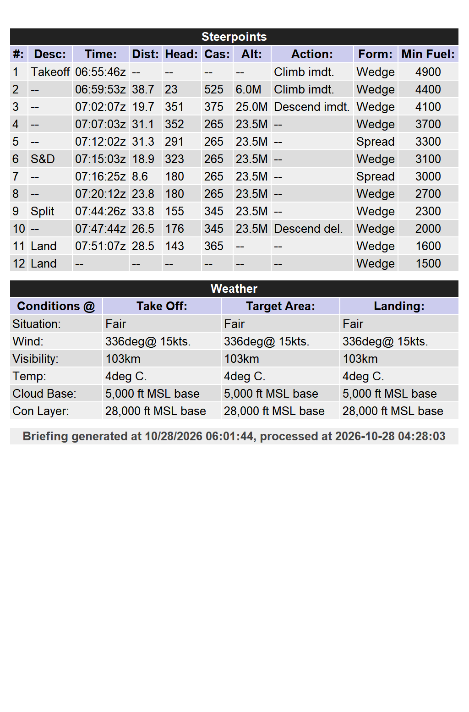 |
| *Package flight calls, tail numbers, TACAN channels, laser codes, and comm presets.* | *Full steerpoint route table, CAS, headings, distance, action points, and weather.* |

| 16k SkyVector Theater Route | Tactical Combat Area Zoom |
| :---: | :---: |
| 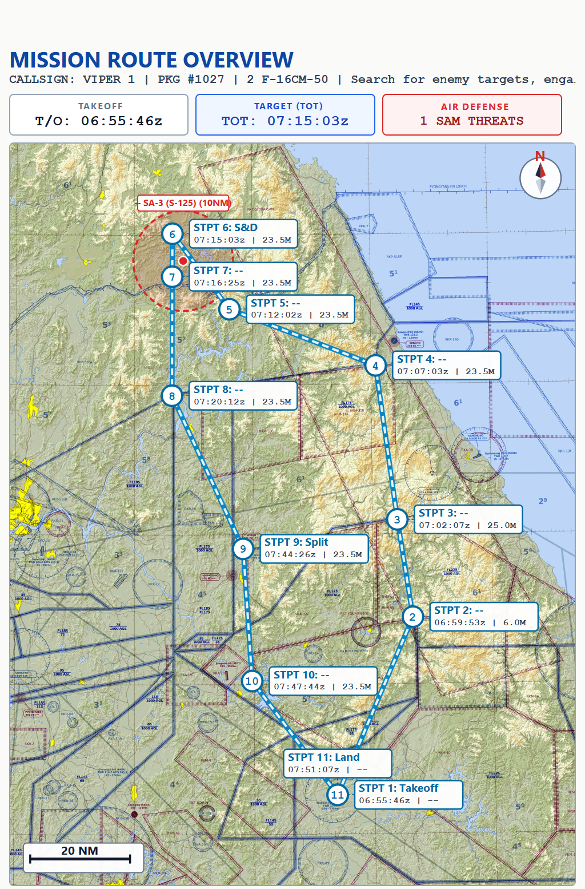 | 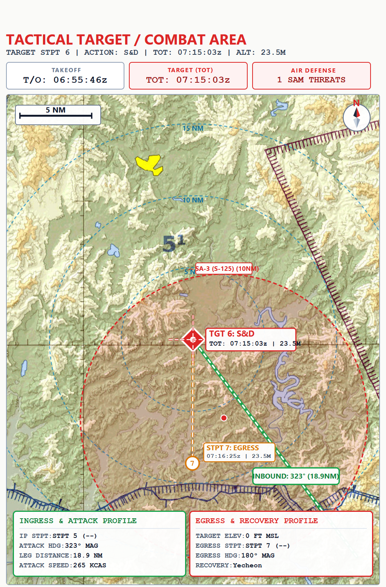 |
| *High-resolution 16k SkyVector base crop with flight path polyline and SAM threat rings.* | *Tactical zoom around Target STPT, IP vector, egress heading, and target coordinates.* |

| Departure Airfield Taxi Chart | Arrival Airfield ILS Approach Plate |
| :---: | :---: |
| 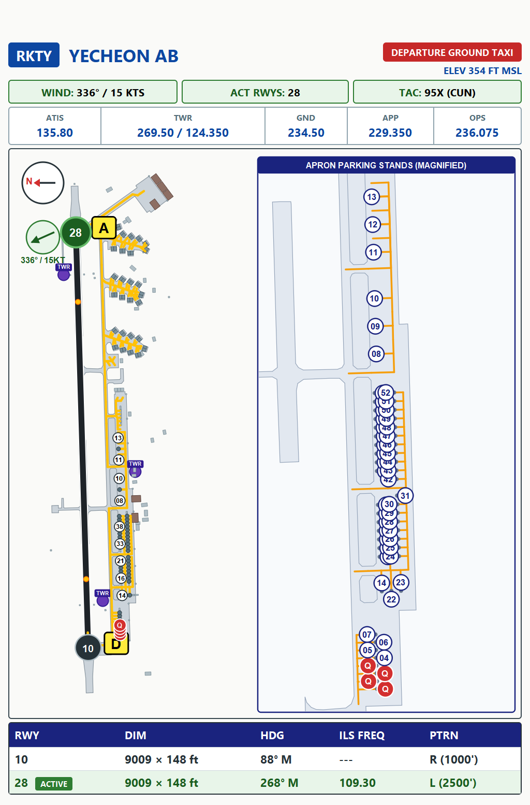 | 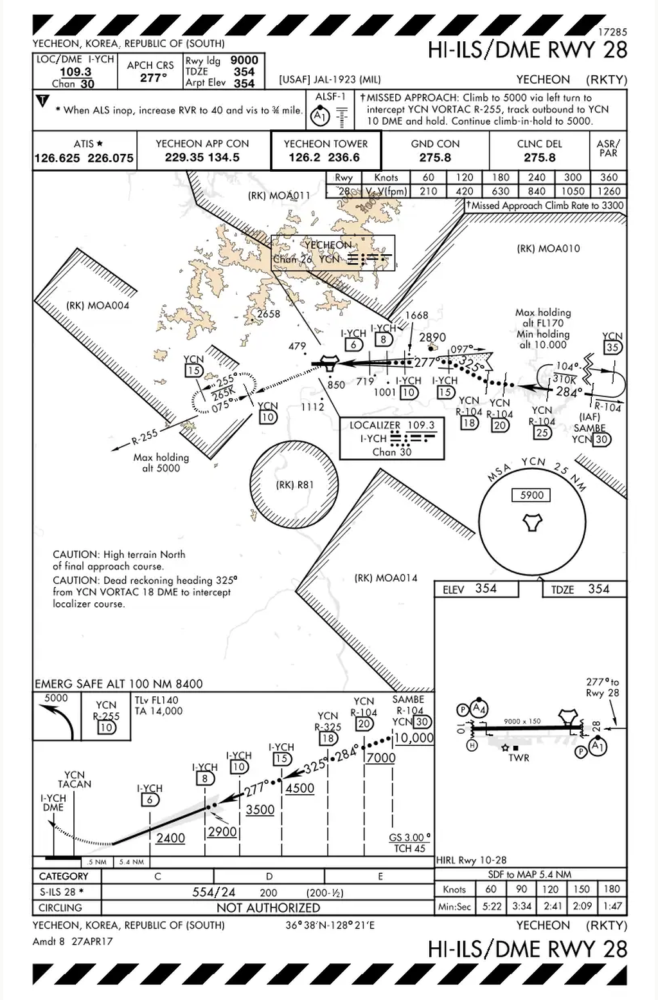 |
| *Ground taxi diagram with active runway badges, parking ramps, and wind indicator.* | *Theater approach plate with frequencies, minimums, glidepath, and inbound course.* |

<p align="center">
  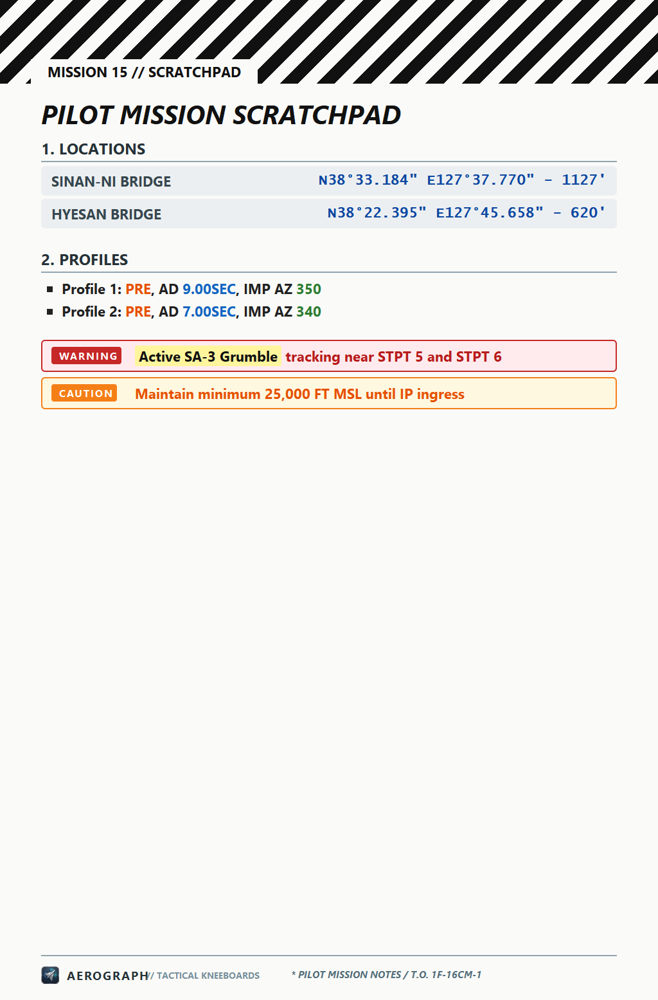<br />
  <em>T.O. 1F-16 POH-Style Custom Mission Notes: Clip-clearing hazard diagonal stripes, asymmetric title notch, and high-contrast pilot scratchpad.</em>
</p>

---

## 💡 Design Philosophy & Origins

AeroGraph was created to address a frustration that I have in Falcon BMS: **the friction of pre-flight setup, alt-tabbing to check what went wrong and desire to use the in-game paper kneeboards instead of dynamic kneeboards**.

### The Motivation
- **Ease-Of-Use, For Me:** I'm a real life pilot (civillian, not military) and I've built some habits throughout the years. I've used iPads and papers on my kneeboard, and I find the paper more reliable and authentic. I was using the Weapon Delivery Planner to update my charts, but I just felt something was off. The text wasn't so readable in VR, and I wanted something _more_ out of it. I found EZBoards quite useful, readable and perfect for this application, yet I wanted to see the airport charts and didn't want to manually select the charts and replace them by hand. Speaking of VR, I _thought_ had problems with the FoxVox's performance (**apparently this wasn't the case**, and found out it was my computer's performance under BMS running in VR, my 4 custom joysticks on 1000 Hz refresh rate, background charts waiting to be refreshed in the background, and FoxVox waiting for inputs on 4000 Hz combined), therefore constant crashes one way or another. I was wondering what will give up first while in the simulator: BMS, my controllers, FoxVox or me. Hence, I started developing this.
- **Automating Chart & Kneeboard Delivery**: The original **EZBoards** and **EZWatch** utilities demonstrated the tremendous value of getting briefed kneeboards into the cockpit. While EZBoards created L1 and R1 pages and EZWatch automatically fetched `briefing.txt`, and I created some `batch` and `python` files to compliment the EZBoards, managing external batch files and separate script tools remained cumbersome. AeroGraph completely rewrites this entire chart generation pipeline in pure, native Rust:
  - I used modified versions of the original EZBoards checklists and custom templates (except for the first two pages, I still love how Logic created them).
  - I do it a bit faster thanks to the Rust, with advanced features (16k SkyVector theater maps with dynamic SAM threat rings, dynamic vector airport ground charts, and T.O. 1F-16 POH scratchpads).
  - I tried to unify the entire pipeline with voice recognition in a single, lightweight application.
- **Single-Process Runtime & Minimised Alt-Tabbing**: While FoxVox provides hands-free muting and somewhat logging on the temp folder, running multiple separate external programs at sim launch often leads to heavy resource consumption, conflicting window hooks, or having to alt-tab out of the 3D cockpit to see why a command failed or whether a background tool crashed. AeroGraph runs as a unified background service with clear Windows system tray status and zero alt-tabbing required for the most of the time. I still need to open the tool that I created if I want to change my own scratchpads, but that's as close as that I can get. Now if one thing goes down, everything goes down 🥲
- **Bundled Customized FoxVox Profile**: AeroGraph comes bundled with an updated, customized version of the Falcon BMS profile for FoxVox (`Falcon BMS 4.38 v1.3.1.fvx`). I have updated and shuffled around several commands and flows to conform more strictly to the Falcon BMS documentation and textbook procedures (I'm still not sure, though). Virtual pilots can seamlessly run this profile out of the box or select their own custom `.fvx` profiles via the tray menu.
- **Theater Support & Validation**: AeroGraph includes coordinate mapping, base charts, and airfield databases for most major Falcon BMS theaters (including addon theaters like Balkans, Israel, etc.), but **Korea (KTO)** is the primary, battle-tested and fully verified default theater.
- **Not a Replacement**: AeroGraph natively executes `.fvx` profiles for low latency and minimal CPU footprint. Creating, recording audio for, or modifying `.fvx` profile structures should always be done inside FoxVox. I cannot top-off Foxster's work on that matter.

> ℹ️ **First-Launch Heads-Up: Initial Cache Generation**  
> On your very first launch, local caches have not yet been built. AeroGraph will decompress the 16k SkyVector base map into a memory-mapped raw cache (around 1 GB or so, be aware), index the theater airfield geometry database, and compile the SAPI binary voice grammar to disk. This one-time initialisation may take 20–30 seconds on initial run, but every subsequent startup and mission update will run at full, instantaneous speed (~1.5 ms voice transitions and sub-second cached renders). Be aware of that when opening the program and clicking the "Print" button for the very first time.

---

## 🛠️ Key Capabilities & Technical Specifications

### What We Do
- **Automated Cockpit Texture Injection**: Intercepts Falcon BMS briefing files (`briefing.txt`) and automatically compiles, formats, and stitches active mission data into 32 kneeboard pages (16 Left and 16 Right pages mapped to DDS textures `7982.dds` through `7997.dds`) thanks to the EZBoards' `briefing.txt` parsing methods.
- **Dynamic Airport Ground Taxi Charts**: Dynamically parses the departure and arrival airfields from your briefing, calculates live wind vectors, selects active runways based on headwind components, and renders detailed vector taxi diagrams with runway dimensions, parking ramps, and frequency ladders.
- **Hardware-Integrated Voice Engine**: Listens for hands-free voice commands via Windows SAPI, sampling HOTAS hardware switches (e.g. MPO toggle, trim switches, speedbrakes) and validating real-time game telemetry from Falcon BMS shared memory, thanks to the FoxVox.
- **Flight-Safe Auto-Updater**: Transparently checks GitHub Releases for application updates without interrupting active simulator flights. If any flights are detected, the updates will wait until BMS is closed.

### How We Do It
- **Pure Rust Architecture**: Zero Electron or Node.js runtime overhead. Direct Win32 COM, DirectInput, and Win32 Memory Mapping APIs.
- **SIMD Multithreaded Texture Compression**: Employs `image_dds` and multi-threaded CPU scopes (`std::thread::scope`) to compress 2048×2048 cockpit textures to BC1/DXT1 in parallel across all CPU cores.
- **SAPI Binary Grammar Serialization**: In-memory compilation of `.fvx` XML grammar rules into native COM binary grammar blobs (`SPBINARYGRAMMAR`), serialized to disk with MD5 state hashing.
- **Headless Vector & HTML Rendering**: Bundled headless WebKit renderer (`wkhtmltoimage`) or local browsers as a backup (Edge or Chrome) executes parallel sub-second page layouts with full CSS styling.

### Why We Do It
- **Tryies to Eliminate Cockpit Alt-Tabbing**: No need to tab out of Falcon BMS to look up steerpoints, ILS frequencies, departure taxi layouts, or comm ladders, or what went wrong.
- **VR Readability without God-Rays**: Replaces harsh pure-white backgrounds with calibrated `#FAFAF8` daylight tinting and bold `#111111` typography, eliminating lens glare and god-rays in VR headsets.
- **Seamless Pilot Workflow**: Save your mission or data cartridge in BMS, and your kneeboards are ready in the cockpit before you ramp start.

---

## 🛫 Dynamic Airport Ground Taxi Charts & Active Runway Calculation

AeroGraph dynamically generates custom airfield ground taxi charts (`dep_taxi` and `arr_taxi`) directly from raw vector airfield geometry databases (`assets/data/airfields/` and `airports/`):

1. **Briefing Wind Extraction**:
   AeroGraph parses the Departure and Arrival weather forecast blocks from `briefing.txt`, extracting exact wind direction and velocity (e.g. `336deg @ 15kts`).
2. **Headwind & Crosswind Calculations**:
   The engine computes the angular offset between the runway magnetic heading and the reported wind vector:
   $$\text{Headwind Component} = \text{Velocity} \times \cos(\text{Wind Dir} - \text{Runway Heading})$$
   $$\text{Crosswind Component} = \text{Velocity} \times \sin(\text{Wind Dir} - \text{Runway Heading})$$
3. **Active Runway Determination**:
   The runway with the highest positive headwind component is chosen as the primary active runway and highlighted with a green **ACTIVE** pill badge on both the map threshold and the runway metadata table.
4. **Vector SVG Map & Detail Inset**:
   - Renders exact paved boundaries, runway centerlines, taxiway routes, and apron parking stands.
   - For sprawling airfields (e.g. Gunsan or Osan), AeroGraph renders a dedicated **Apron Parking Stands Magnification** inset so pilots can identify their assigned parking spot at a glance.
   - Overlays a dynamic wind arrow showing exact direction and velocity in knots.
   - Still looks a bit overcrowded, but working with SVG creation dynamically is not easy, I'll try to make it better in time.
5. **Aviation Metadata Ladder**:
   Includes airport ICAO, field elevation, active ATIS, Tower, Ground, Departure, and Approach frequencies, TACAN channel, runway dimensions ($L \times W$), magnetic headings, ILS localizer frequencies, and traffic pattern direction.

---

## ⚡ Detailed Performance Optimizations & SAPI Compaction

AeroGraph has been engineered from the ground up for minimal sim footprint and instantaneous updates:

### 1. SAPI Database Compaction & Hierarchical Prefix-Tree
In standard FoxVox profiles, combining every agency prefix (*"Gunsan Tower"*, *"Tower"*, *"Departure"*, *"Approach"*) with every command variation in a flat list resulted in **over 37,000 distinct phrase transitions**. Compiling this flat database in SAPI previously took **68 seconds** on every aircraft change (on my slow PC, of course).

AeroGraph prunes and restructures the SAPI grammar into a **2-stage hierarchical state machine**:
```
RootRule ──[ Agency Prefix: e.g. "Gunsan Tower" ]──► GroupState ──[ Command: e.g. "Inbound" ]──► Terminal
```
- **97% Reduction in SAPI Graph Complexity**: SAPI transitions drop from **37,000+ to ~1,000**.
- **Binary SAPI Serialization (< 2 ms Loading)**: Compiled grammars are saved via `CreateStreamOnHGlobal` to `%APPDATA%\ygz\AeroGraph\config\cache\`. On mode transitions (e.g. Crew Chief vs. Cockpit Comms), cache hits load via `LoadCmdFromMemory()` in **under 2 milliseconds (~1.5 ms)**, completely eliminating mode-switching delays.

### 2. Parallel Multi-Core DDS Compression
Compressing 16 texture pairs (`7982.dds` through `7997.dds`) sequentially takes ~16 seconds. AeroGraph batches Left and Right pages and dispatches BC1/DXT1 SIMD compression across CPU threads using `std::thread::scope`, reducing total DDS generation time to **under 1.5 seconds**.

### 3. Texture Pair Batching
Left (`X=0`) and Right (`X=1024`) pages are batched into a single 2048×2048 texture pass per slot pair, cutting disk I/O and compression overhead in half.

### 4. 16k SkyVector Base Map Raw Caching
Decodes the 16k SkyVector theater base map once into a memory-mapped raw binary cache (`.raw` + `.json`), eliminating image decoding overhead during subsequent flight crops.

### 5. WebKit Incremental Content Caching
Hashes HTML template content for custom notes and checklist cards. If the text has not changed, rendering is skipped entirely and cached PNGs are reused instantly.

### 6. Selective Skipping
If `mission_route` or `mission_target` are not assigned in `kneeboards.json`, base map decoding is completely bypassed. If taxi diagrams are not assigned, airport geometry parsing is completely bypassed.

---

## 🔍 Tested & Verified Versions

- **Falcon BMS**: **4.38.1** (and 4.38.0).
- **FoxVox**: **Falcon BMS 4.38 v1.3.1 profile**.
- **Operating System**: **Windows 10 (64-bit)** and **Windows 11 (64-bit)**.
- **Display Modes**: 2D Flat Screen, TrackIR / Head-Tracking, and VR (Virtual Reality).

---

## 🚀 Setup & First-Time Configuration Guide

### 1. Falcon BMS Briefing Requirement & Workflow

AeroGraph's automated kneeboard generator monitors `User/Briefings/briefing.txt` in real time. For this workflow to function:

#### Step A: Configure BMS Briefing Settings (One-Time Setup)
1. Open the Falcon BMS Launcher and open the **Configuration** menu.
2. Navigate to **General > Briefing/Debriefing**:
   - Ensure **`1. Briefing Output to File`** is **ENABLED** (checked).
   - Ensure **`2. Append New Briefings`** is **DISABLED** (unchecked).
   - Ensure **`3. HTML Briefings`** is **DISABLED** (unchecked).

<p align="center">
  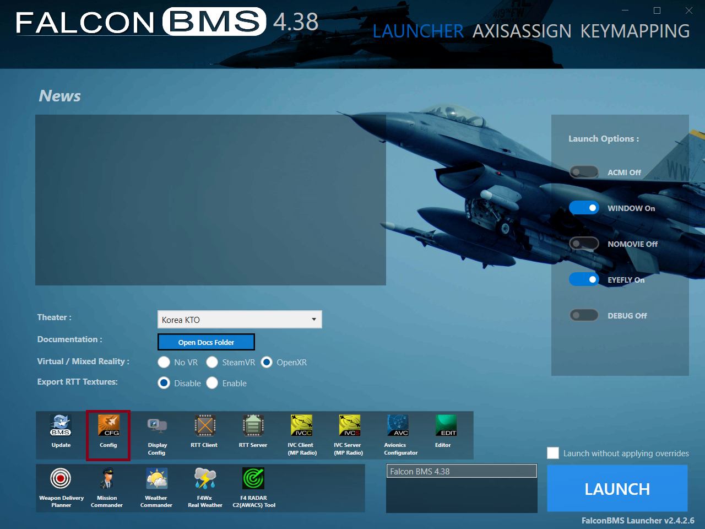<br />
  <em>Step 1: Ensure 'Briefing Output to File' is enabled in BMS Configuration.</em>
</p>

<p align="center">
  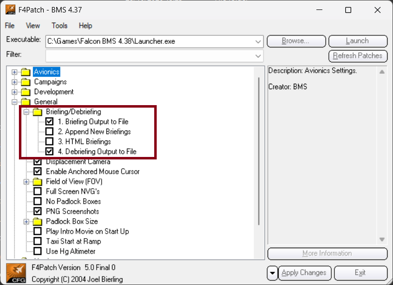<br />
  <em>Step 2: Ensure 'HTML Briefings' is disabled so Falcon BMS generates plain text briefing.txt.</em>
</p>

#### Step B: Exporting the Briefing in BMS UI
Whenever you plan a mission in Campaign or Tactical Engagement:
1. Complete your flight planning, steerpoint editing, package setup, and Data Cartridge (DTC) saving.
2. Click the **Briefing** button at the bottom of the mission screen.
3. Click the **Print** button located in the top-right corner of the Briefing window:

<p align="center">
  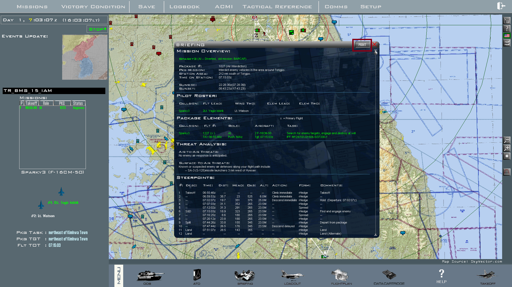<br />
  <em>Click the 'Print' button in the BMS Briefing window to generate User/Briefings/briefing.txt.</em>
</p>

4. Falcon BMS immediately outputs `briefing.txt`. AeroGraph detects the change in milliseconds, renders your complete kneeboard suite, and injects textures directly into your cockpit. It can take a few seconds, just wait for `DATA` sound (you'll understand when you hear it), and than you are ready for departure!

---

### 2. HOTAS & Controller Configuration (MPO Switch Mapping)

Flight controls, PTT, and cockpit keybindings are mapped inside Falcon BMS directly, and requires no further configuration.

> **Note:** This is the way I could make it work. If your instance can check the MPO switch out of the box, you can keep you current configuration, or skip this step entirely.

During the cold ramp start checklist, you initiate the Big Movements check with the crew chief. To validate the physical **MPO (Manual Pitch Override)** kick test, map your physical MPO toggle switch in your FoxVox profile:

1. Launch FoxVox and ensure your active profile (`Falcon BMS 4.38 v1.3.1.fvx`) is loaded.
2. Click the **Voice Configuration** toggle button on the left sidebar to switch to **Key Configuration** mode:
   <p align="center">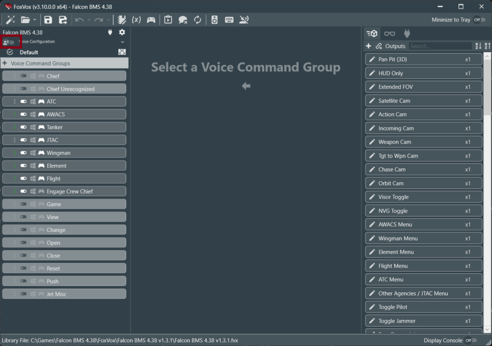</p>

3. Select **Crew Chief Interactions** from the command categories:
   <p align="center">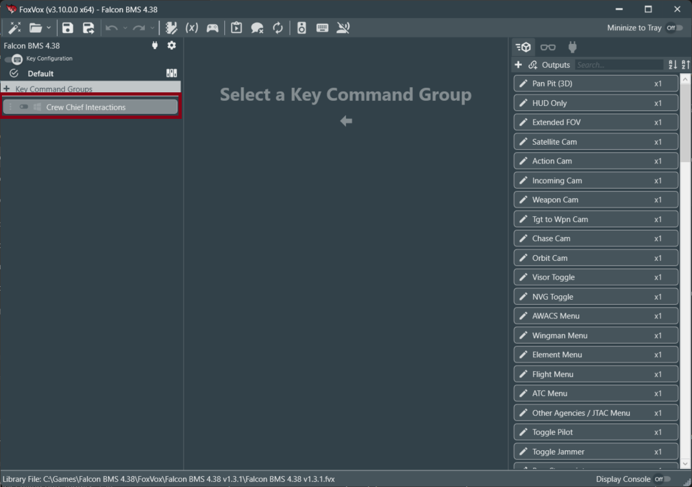</p>

4. Click **MPO Switch Toggle** in the action list:
   <p align="center">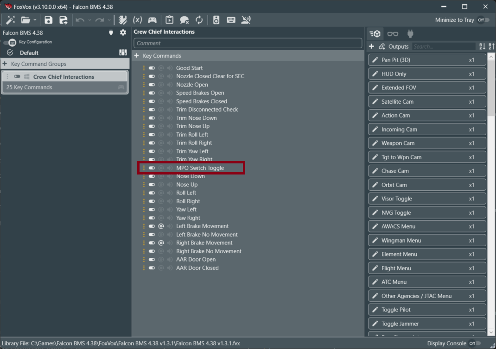</p>

5. Hover over any existing assignment and click the trash icon to clear it if needed. Then click the **`+`** icon to add a controller input:
   <p align="center">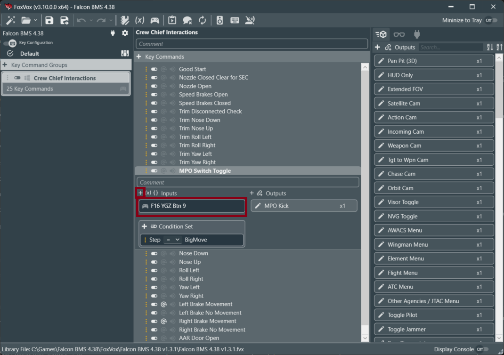</p>

   > Again, if it works for you already, you don't need to change anything here.

6. Press the physical button, toggle switch, or keyboard shortcut that controls the MPO switch in Falcon BMS:
   <p align="center">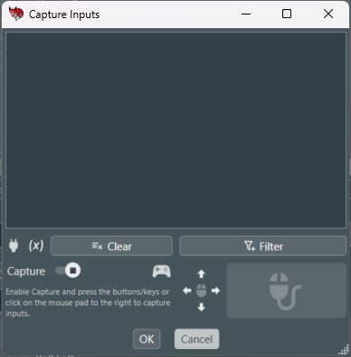</p>

7. Once the button or DX input is detected, click **OK** to save the binding:
   <p align="center">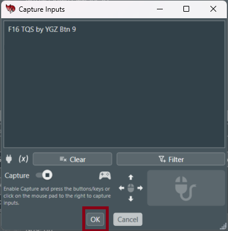</p>

8. Save the profile (**Ctrl+S** or the Save icon on the top toolbar).

> 💡 **Tip:**
> The MPO kick test is completely optional. If unmapped or skipped, ground crew operations proceed without interruption.

### 3. Application Preferences (`aerograph.toml`)
AeroGraph automatically creates and manages its settings file at:
```
%APPDATA%\ygz\AeroGraph\config\aerograph.toml
```

Key configuration options include:
```toml
# Path to the active FoxVox aircraft profile (.fvx), it automatically changes this via the selected profile
profile_path = 'C:\Games\Falcon BMS 4.38\FoxVox\Falcon BMS 4.38 v1.3.1\Falcon BMS 4.38 v1.3.1.fvx'

# DirectInput hardware sampling rate (Hz), in case your controllers making the program run slow
polling_rate_hz = 25

# Pilot response voice (false = Male, true = Female), required for FoxVox profile
pilot_female = false

# SAPI audio feedback cues, the default "beeps" of the Microsoft voice detection. Quite annoying if on, hence off by default.
sapi_earcons = false

# Show console diagnostic window on launch, editable via tray icon
show_console = false

# Voice recognition listening state, editable via tray icon
listening_enabled = true

# Live file monitoring on User/Briefings/briefing.txt
auto_kneeboards = true

# Sound cue playback ("DATA" sound effect) on kneeboard updates
play_sound_on_update = true

# Auto-Updater Settings
check_updates_on_startup = true
github_repo = "yagiziskirik/AeroGraph"
```

Some of these settings like `listening_enabled` and `show_console` can be altered via the tray menu. In case you need to change something manually (like for the future, you want to fetch the updates from another fork), this is where you change it.

---

## 📋 Kneeboard Configuration (`kneeboards.json`)

When AeroGraph starts, if `kneeboards.json` is missing from the application folder, it **automatically generates** a comprehensive 32-slot configuration file detailing all 16 Left and 16 Right pages:

| Slot Range | Cockpit Texture | Typical Left Page | Typical Right Page |
| :---: | :---: | :---: | :---: |
| `F16_1L` / `F16_1R` | `7982.dds` | Briefing: Roster & Comms Ladder | Briefing: Steerpoints & Weather |
| `F16_2L` / `F16_2R` | `7983.dds` | Engine Start Checklist | Air-to-Air Threat Reference |
| `F16_3L` / `F16_3R` | `7984.dds` | Taxi & Takeoff Checklist | SAM Threat Guide |
| `F16_4L` / `F16_4R` | `7985.dds` | TACAN & AAR Checklist | Mission Route Overview Map |
| `F16_5L` / `F16_5R` | `7986.dds` | Fence-In Combat Checklist | Tactical Target Area Zoom |
| `F16_6L` / `F16_6R` | `7987.dds` | Weapons Employment Guide | Departure Airfield Taxi Chart |
| `F16_7L` / `F16_7R` | `7988.dds` | T.O. 1F-16 POH Scratchpad | Pilot Mission Directives / SPINS |
| `F16_8L` – `F16_16R` | `7989.dds`–`7997.dds` | Approach Speeds, Limits, EPs | Arrival ILS Plates & Blank Cards |

### Available Page Types

| Type | Description | Key Parameters |
| :--- | :--- | :--- |
| `briefing_roster` | Package callsigns, tail numbers, laser codes, TACAN channels, and comm presets. | None |
| `briefing_steerpoints` | Steerpoint table (alt, CAS, heading, distance, fuel) and weather report. | None |
| `mission_route` | 16k SkyVector theater map crop with flight route and SAM threat rings. | None |
| `mission_target` | Tactical combat zoom around Target STPT, IP vector, and egress profile. | None |
| `dep_taxi` | Departure airfield ground taxi diagram, active runways, wind arrow, and parking. | None |
| `arr_taxi` | Recovery airfield ground taxi and parking chart. | None |
| `arr_ils_primary` | Primary arrival runway ILS approach chart. | None |
| `arr_ils_secondary` | Secondary arrival runway ILS approach chart (or fallback blank card). | None |
| `notes` | **T.O. 1F-16 POH-Style Flight Notes & Scratchpad** with hazard stripes. | `"notes": [...]` or `"path": "notes/file.md"` |
| `custom_html` | Renders a custom HTML template. | `"path": "custom/checklist.html"` |
| `blank` | Calibrated daylight Intentionally Left Blank card (`#FAFAF8`). | `"title": "...", "reason": "..."` |
| `image` | Displays any external PNG or JPG image directly. | `"path": "path/to/image.png"` |
| `restore_original` | Restores stock BMS texture directly from `Docs/07 Kneeboard Templates/F-16/DDS_Backup`. | None |
| `pass_through` | Preserves existing texture on that half untouched. | None |

---

## 📝 T.O. 1F-16 POH Custom Notes & Scratchpad Guide

The `notes` page type gives pilots a rapid way to add custom mission directives, SPINS, ROE, pilot scratchpads, or emergency checklists directly to their kneeboards without needing graphic editors or HTML knowledge.

### Aviation Technical Order Aesthetic
- **Top Diagonal Stripe Banner**: A full-width, 150px tall diagonal stripe banner across the top header extends well below the physical 3D cockpit kneeboard clip.
- **Asymmetric Clip-Aware Title Notch**:
  - **Left Pages (`*L`)**: Embedded title box positioned on the **Top-Left**.
  - **Right Pages (`*R`)**: Embedded title box positioned on the **Top-Right**.
  - Guarantees the central physical cockpit clip never obscures your reference title or T.O. code.
- **Comfortable Side Inset**: Generous horizontal padding (64px) keeps your text comfortably inset from cockpit boundaries.
- **Clean Footer**: AeroGraph tactical wings emblem badge and metadata are placed in the bottom footer, keeping the header uncluttered.

---

### Input Methods: Inline JSON vs. External Files

You can provide notes either directly in `kneeboards.json` or by pointing to an external `.txt` or `.md` file:

#### 1. Inline Array of Strings (Recommended for direct JSON editing):
```json
"F16_7L": {
  "type": "notes",
  "title": "MISSION SPINS & RULES OF ENGAGEMENT",
  "subtitle": "FLIGHT: VIPER 1 • THEATER: KOREA",
  "header_code": "T.O. BMS1F-16CM-1",
  "page_num": "SPINS-1",
  "preset": "caution",
  "spaced": false,
  "notes": [
    "## 1. BVR COMBAT RULES OF ENGAGEMENT",
    "- Hostile criteria: 2x sensor confirmation or AWACS Bogey Dope {yellow: 'HOT/HOSTILE'}",
    "- Weapons Free beyond {green: 25nm} Bullseye 045/60",
    "- Primary Laser Code: {green: 1688} / Secondary: {yellow: 1111}",
    "",
    "BULLSEYE: {blue: 045 / 60NM}",
    "PACKAGE VHF: {blue: 138.250}",
    "RAMROD: {blue: CHARLIE}",
    "",
    "## 2. IN-FLIGHT CHECKLIST",
    "[x] INS Alignment verified & UFC set",
    "[ ] Master Arm {yellow: ARM} at STPT 4 (Fence In)",
    "[ ] Laser Arm {green: ON} prior to 5nm to Target",
    "",
    "WARNING: {highlight: Active SA-10 Grumble} radar tracking near STPT 6",
    "CAUTION: Maintain minimum 18,000 FT MSL until IP ingress"
  ]
}
```

#### 2. External `.txt` or `.md` File:
```json
"F16_7R": {
  "type": "notes",
  "title": "DIVERT AIRFIELDS & RECOVERY",
  "header_code": "T.O. 1F-16CM-1",
  "page_num": "DIVERT-1",
  "preset": "tactical",
  "path": "notes/divert_airfields.md"
}
```
You can simply open `notes/divert_airfields.md` in any editor, type your flight notes using standard markdown tags, save, and AeroGraph will render it into your cockpit textures.

---

### 🎨 Notes Color Customization & Presets

You can customize the top hazard stripe pattern and header bar colors using built-in presets or custom HEX color lists:

#### 1. Using a Preset with Spaced Stripes (Authentic Checklist Style):
```json
"F16_7L": {
  "type": "notes",
  "title": "MISSION SPINS & RULES OF ENGAGEMENT",
  "preset": "caution",
  "spaced": true,
  "notes": [...]
}
```

#### 2. Using Custom Multi-Color Stripes & Dense Mode:
```json
"F16_8L": {
  "type": "notes",
  "title": "TACTICAL AIR CONTROL PARTY (TACP)",
  "header_code": "CAS 9-LINE",
  "page_num": "CAS-1",
  "stripe_colors": ["#111111", "#0D47A1", "#0288D1"],
  "header_color": "#0D47A1",
  "spaced": false,
  "notes": [...]
}
```

#### Available Presets:
- `"caution"`: Alternating Black & Safety Yellow diagonal stripes (`["#111111", "#F5D742"]`).
- `"warning"`: Alternating Black & Hazard Red diagonal stripes (`["#111111", "#D32F2F"]`).
- `"emergency"`: Pure Hazard Red diagonal stripes (`["#D32F2F"]`).
- `"tactical"` or `"blue"`: Navy & Tactical Blue diagonal stripes (`["#0D47A1", "#0288D1"]`).
- `"green"`: Deep Forest & Tactical Green diagonal stripes (`["#1B5E20", "#388E3C"]`).
- `"standard"` or `"black"`: Solid classic Black & White stripes (default).

#### Stripe Spacing (`spaced`):
- **`spaced`** (boolean, default: `true`): Keeps clean white background spacing between each colored stripe line (e.g. `Black, White, Yellow, White` or `Red, White, Red, White`), matching authentic T.O. 1F-16 checklist cards.
- Set `"spaced": false` for dense stripes that alternate every single line with no white gap (e.g. `Black, Yellow, Black, Yellow`).

#### Custom Colors:
- **`stripe_colors`**: Provide an array of 2 or more HEX colors to alternate across the hazard pattern:
  ```json
  "stripe_colors": ["#111111", "#F5D742", "#D32F2F"]
  ```
- **`stripe_color`**: Provide a single HEX color for a 2-tone pattern with the page background:
  ```json
  "stripe_color": "#D32F2F"
  ```
- **`header_color`**: Override the notch header text color independently:
  ```json
  "header_color": "#0D47A1"
  ```

---

### 🎨 Notes Markdown Formatting Syntax Reference

| Syntax | What it produces | Visual Appearance |
| :--- | :--- | :--- |
| `# Title` | **Primary Section Banner** | Blue highlight bar with dark blue accent left border |
| `## Section` | **Secondary Section Header** | Bold dark header with horizontal underline |
| `### Subheader` | **Minor Subhead** | Compact slate-gray subhead |
| `[SECTION]` | **Category Pill Badge** | Dark rectangular badge with bold white text |
| `WARNING: text` | **Safety Alert Box** | Red-bordered callout box with a bold `WARNING` badge |
| `CAUTION: text` | **Advisory Caution Box** | Amber-bordered callout box with a bold `CAUTION` badge |
| `[ ] Item` or `- [ ] Item` | **Empty Checkbox** | Square checkbox for pending cockpit checklist items |
| `[x] Item` or `- [x] Item` | **Checked Box** | Green square with checkmark for completed items |
| `- Item` or `* Item` | **Bullet Point** | Clean list item with square bullet dot |
| `KEY: VALUE` | **Two-Column Data Card** | Monospace highlight badge (e.g. `BULLSEYE: 045 / 60NM`) |

#### Inline Text Coloring:
Use `{color: text}` anywhere in your titles, keys, values, warnings, cautions, and checklist items:
- `{red: text}`, `{yellow: text}`, `{green: text}`, `{blue: text}`, `{orange: text}`, `{cyan: text}`, `{gray: text}`, `{black: text}`
- `{#E91E63: custom hex color}`
- `{highlight: yellow marker highlight}` or `{bg-yellow: text}`
- `{bg-red: text}`, `{bg-green: text}`, `{bg-blue: text}`, `{white: white text on dark badge}`

---

## 🎙️ Crew Chief & Voice Commands Reference

For a complete breakdown of all available voice interactions, dialogue trees, hardware DirectInput bindings, and T.O. 1F-16 cockpit procedures, see the dedicated reference:

👉 **[Crew Chief & Cockpit Voice Engine Guide](docs/VOICE_COMMANDS.md)**

### Key Highlights:
- **System Commands**: Say `"Stand by"` to mute recognition before speaking on human comms; say `"Radio check"` to resume.
- **Crew Chief Flow**: Ground power, start cart, wheel chocks, EPU pinning/unpinning, flight control checks, and speedbrakes.
- **Hardware-Validated MPO Kick Check**: Validates the physical toggle of your HOTAS MPO switch during the FLCS BIT ground test.

---

## 🖥️ System Tray Controls

Right-click the AeroGraph icon in the Windows notification area to access:

- **Profile: [Profile Name]**: Displays currently active aircraft voice profile.
- **🎙️ Listening Mode**: Toggle voice recognition on/off (also controllable hands-free via *"Stand by"* / *"Radio check"*).
- **Pilot Voice**: Toggle between Male and Female pilot voice responses.
- **Select .fvx Profile...**: Browse and load different FoxVox aircraft profiles.
- **Reload Profile**: Re-compile and reload the active profile grammar.
- **📋 Auto-Kneeboards**: Toggles automatic file-watching on `User/Briefings/briefing.txt`.
- **📝 Edit Kneeboards**: Opens `kneeboards.json` directly in Notepad.
- **⚡ Regenerate Kneeboards Now**: Manually triggers the complete generation pipeline.
- **📁 Open Kneeboard Images**: Opens the intermediate PNG page directory.
- **🚀 Start with Windows**: Toggle automatic startup on Windows boot (I don't use it, but in case you need it).
- **Show/Hide Console Window**: Toggle diagnostic console output.
- **🔄 Check for Updates...**: Manually checks GitHub for new releases.
- **Open Log File**: View application logs (`aerograph.log`).
- **Exit AeroGraph**: Clean application shutdown.

---

## 🚫 What AeroGraph Is NOT Replacing

- **Not a Mission Commander (MC)**: AeroGraph does not create flight plans, edit Falcon BMS campaign files, or modify Air Tasking Orders (ATOs).
- **Not a Weapon Delivery Planner (WDP)**: AeroGraph reads generated mission data; it does not replace external flight planning suites.
- **Not a FoxVox Profile Creator**: FoxVox is required to record, configure, or modify `.fvx` profiles. AeroGraph provides a unified native runtime that executes those profiles. Installing [FoxVox](https://foxster.itch.io/foxvox) is highly recommended.

---

## ⚠️ Limitations & Operational Caveats

- **Notes Templates**: POH markdown reference files in `notes/` (`aa_missiles.md`, `divert_airfields.md`, etc.) are read by AeroGraph. If deleted, they must be restored from the installer or repository. That's if you need the originals. If you've changed them to something else, you can delete them, of course.
- **Voice Profiles**: Voice profiles must be authored in FoxVox and follow FoxVox XML conventions.
- **F-16 Specific Cockpit Mapping**: Kneeboard texture positions (`7982.dds` through `7997.dds`) are calibrated for the Falcon BMS F-16 cockpit.
- **Single Instance**: AeroGraph utilizes a Windows named mutex (`AeroGraph_SingleInstance_Mutex`) to ensure only one instance runs at any time.

---

## ❓ Frequently Asked Questions (FAQ) & Troubleshooting

### Q: Voice engine is not responding to my commands?
1. Check the system tray icon: ensure **🎙️ Listening: Active** is displayed (say *"Radio check"* or right-click to unmute).
2. Verify your default recording device in Windows Sound Settings.
3. Confirm that Windows Speech Recognition (SAPI 5.4+) is enabled in Windows Settings.
4. If Windows Speech Recognition is not working, not activated or installed, you can [install them within the settings](https://support.microsoft.com/en-us/education/learning-accelerators/download-languages-and-voices-for-immersive-reader-read-mode-and-read-aloud) and restart your computer to check the settings again.

### Q: Kneeboards are not regenerating when I change flights in BMS?
1. Verify that Falcon BMS briefing output is enabled and saved as **Text (.txt)** format, not HTML.
2. Verify that **📋 Auto-Kneeboards: Enabled** is checked in the system tray menu.
3. Open `kneeboards.json` and check for JSON syntax errors (missing commas or unclosed brackets).
4. You can checkout the console (if open) or logs for an error, it usually tells you what is missing.

### Q: How do I restore original stock Falcon BMS kneeboards?
- **For specific slots**: Set `"type": "restore_original"` in `kneeboards.json` for that slot and recreate the kneeboards manually, or wait until it generates again on new `briefing.txt`.
- **On uninstall**: When running the uninstaller, select **Yes** when prompted to restore stock F-16 textures from `Docs/07 Kneeboard Templates/F-16/DDS_Backup`.

---

## 📦 Installation & Uninstallation

### Installing via Graphical Setup Wizard
1. Download `AeroGraph_Setup_v0.1.0.exe` from [GitHub Releases](https://github.com/yagiziskirik/AeroGraph/releases).
2. Run the installer. AeroGraph installs to `%LOCALAPPDATA%\Programs\AeroGraph` without requiring administrator privileges.
3. Choose whether to create a Desktop shortcut and whether to launch on Windows startup.
4. Click **Finish** to launch AeroGraph.

### Flight-Safe Auto-Updater
AeroGraph automatically checks for updates on startup. If an update is available:
- **During Flight**: If `Falcon BMS.exe` is currently running, update notifications are automatically suppressed until your flight session ends.
- **Silent Upgrade**: When accepted, AeroGraph downloads the latest setup installer, closes the app cleanly, installs the update silently, and relaunches automatically.

### Clean Uninstallation
1. Open Windows **Settings > Apps > Installed apps** (or `appwiz.cpl`).
2. Select **AeroGraph** and click **Uninstall**.
3. Choose whether to keep or remove your custom `kneeboards.json` and `%APPDATA%` preferences.
4. If Falcon BMS is detected, the uninstaller offers to restore stock F-16 kneeboard textures.

---

## 🔨 Building from Source

### Prerequisites
- **Rust Toolchain**: 1.75 or later (`rustup default stable`).
- **Windows SDK**: Required for `rc.exe` (resource compiler used to embed icon and metadata).
- **Inno Setup 6**: Required to build the standalone graphical setup installer (`winget install JRSoftware.InnoSetup`).

### Compile Release Binary
```powershell
git clone https://github.com/yagiziskirik/AeroGraph.git
cd AeroGraph
cargo build --release
```

### Build Standalone Setup Executable
```powershell
powershell -ExecutionPolicy Bypass -File .\installer\build_installer.ps1
```
The output installer will be created at:
```
installer\output\AeroGraph_Setup_v0.1.0.exe
```

---

## 🤝 Community Credits & License

AeroGraph stands on the shoulders of the fantastic work done by the creators of the original FoxVox and EZBoards for Falcon BMS. This Rust rewrite would not have been possible without their foundational efforts and their gracious permission to let me carry the project forward.

A massive thank you to:
- **[FoxVox by Foxster](https://foxster.itch.io/foxvox)**: Creator of the [FoxVox](https://foxster.itch.io/foxvox) application and author of the FoxVox Falcon BMS VCC profile library (`Falcon BMS 4.38 v1.3.1.fvx`). AeroGraph executes these profiles natively in Rust for zero background footprint and sub-millisecond response. For comprehensive video guides on configuring voice keys and controller bindings, visit **[Foxster's YouTube Channel](https://www.youtube.com/@foxster2)** and the **[FoxVox Video Tutorials](https://foxster.itch.io/foxvox/devlog/870907/foxvox-tutorial-videos)**. This project wouldn't be possible without Foxster, and I am incredibly grateful for his blessing to let me integrate and build upon his brilliant work.
- **Voice Audio & Sound Design by [Bogey Dope](https://www.youtube.com/@BogeyDope)**: The incredible and immersive pilot response audio, ground crew recordings, and sound design. I'm a huge fan, by the way, and I want to extend a special thank you to him for graciously allowing me to include these legendary recordings that bring the sim to life!
- **Startup Procedure Contribution by Tomcattwo**: The brains behind the updated cold start checklist and ground crew flow contributed to the original FoxVox. Before creating this program, I also relied heavily on his fantastic [WDP map and airport integrations](https://forum.falcon-bms.com/topic/30760/updated-4.38-maps-and-airports-for-weapon-delivery-planner-wdp). A huge thank you to him for creating that amazing flow!
- **EZBoards / EZCharts by "Logic"**: Original concept, dynamic data generation from the `briefing.txt` file, the checklist and package pages designs, and kneeboard layout templates ([Falcon BMS Forum](https://forum.falcon-bms.com/topic/19901/ezboards-instant-single-click-briefing-to-kneeboards-conversion)). AeroGraph features a ground-up pure Rust rewrite of the chart generation pipeline for automated, sub-second cockpit delivery with its own new features. Without Logic, you wouldn't see those automated first two pages and the quality checklists. A huge thank you to him for giving me the green light and permission to rewrite and evolve his original creation. An amazing person to chat with!
- **The Falcon BMS Community**: Special thanks to Benchmark Sims (BMS), the forum community, and all the flight sim pilots, mission designers, and profile contributors whose decades of passion and dedication continually drive this simulation forward. I wanted to contribute somehow, I hope you will like it.

AeroGraph's original Rust source code, airfield vector databases, and build scripts are licensed under the [MIT License](LICENSE). Third-party community assets (FoxVox profiles, Bogey Dope audio recordings, and EZBoards-inspired layout templates) remain under the exclusive copyright of their respective authors and are strictly non-commercial. Sublicensing, monetizing, or commercial exploitation of bundled community assets is strictly prohibited (see [LICENSE](LICENSE) for full terms and author removal policies).
