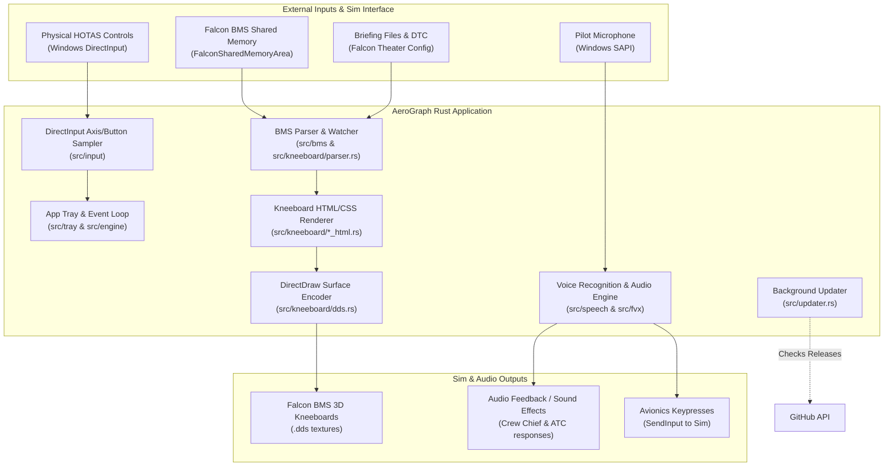

# AeroGraph Architecture & System Design

This document outlines the high-level architecture, subsystem boundaries, data flow, and threading model of AeroGraph. It is designed to help maintainers and contributors understand how AeroGraph integrates with Falcon BMS and Windows flight hardware without needing to reverse-engineer individual source files.

---

## 1. System Overview

AeroGraph is a native, high-performance Windows desktop application built in Rust for the **Falcon BMS 4.38** flight simulator. It serves two primary operational roles:

1. **Automated Cockpit Kneeboard Generation**: Reads Falcon BMS shared memory, theater configuration, and briefing/DTC files to dynamically generate high-resolution, vector-quality kneeboard pages (departure, arrival ILS plates, steerpoints, threats, roster, POH notes) and compile them directly into DirectDraw Surface (`.dds`) textures in the pilot's 3D cockpit.
2. **Authentic Voice & Avionics Integration**: Natively executes FoxVox voice profiles (`.fvx`) using Windows SAPI (Speech API) to provide realistic voice interaction with the Crew Chief (ramp start sequences), ATC, AWACS, Tanker, JTAC, and cockpit avionics switches with Bogey Dope audio feedback.

---

## 2. High-Level Subsystem Map

---

## 3. Subsystem Breakdown

### `src/bms/`: Sim State & Theater Integration
- **`shared_memory.rs`**: Interfaces with Windows shared memory (`OpenFileMappingW` / `MapViewOfFile`) to read telemetry from the running Falcon BMS instance (`FlightData`, radio states, avionics modes).
- **`config_parser.rs`**: Resolves Falcon BMS installation paths, active theater directories (e.g. Korea, Balkans), and DTC profiles from the Windows registry and config files.

### `src/kneeboard/`: Kneeboard Generation & DDS Pipeline
- **`parser.rs`**: Parses raw Falcon BMS mission briefing text files, extracting flight plans, steerpoints, threat envelopes, PPTs, Link 16 network assignments, and package rosters.
- **`*_html.rs` & `*_render.rs`**: Generates high-contrast, cockpit-optimized HTML/CSS layouts for:
  - Departure and arrival airport diagrams
  - ILS approach plates
  - Steerpoint flight data and threat radar rings
  - Package pilot rosters and POH flight notes
- **`crop.rs` & `runways.rs`**: Calculates geographic bounds and vector projections for airport taxiways, runways, and threat rings.
- **`dds.rs`**: Encodes rasterized page images into DirectDraw Surface (`.dds`) format conforming to the exact dimensions, color formats, and mipmap layouts required by Falcon BMS cockpit texture managers.
- **`watcher.rs`**: Monitors theater folders and briefing updates to trigger automatic, real-time kneeboard regeneration when mission state changes.

### `src/speech/` & `src/fvx/`: Voice Recognition & FoxVox Engine
- **`sapi.rs`**: Interfaces with the Windows Speech API (SAPI) to build low-latency grammar trees from voice profile definitions.
- **`loader.rs` & `models.rs`**: Parses `.fvx` profiles directly in Rust without external runtime dependencies.
- Translates pilot voice calls (Crew Chief ramp startup sequences, ATC departures, AWACS threat calls, radio channel pushes) into simulated cockpit keypresses and authentic audio playback.

### `src/input/`: HOTAS & Controller Sampling
- **`direct_input.rs` & `axis_sampler.rs`**: Captures hardware events from connected flight controllers (joysticks, throttles, rudder pedals) via DirectInput, allowing physical button bindings for in-flight interactions.

### `src/engine/` & `src/tray/`: Application Shell & State
- **`app_tray.rs`**: Implements the native Windows system tray icon, notification menus, audio mute controls, and setup dialogues.
- **`state.rs` & `audio.rs`**: Manages global application state, thread synchronization, and sound effect playback.
- **`updater.rs`**: Background thread that checks `GET /repos/yagiziskirik/AeroGraph/releases/latest` on launch to notify pilots when an update is available.

---

## 4. Architectural Stability Guidelines

To minimize maintenance overhead, this document focuses on **subsystem responsibilities and system boundaries** rather than internal function signatures.

> [!TIP]
> **When does this document need an update?**
> - When a **new subsystem** is introduced (e.g., a new protocol, network sync, or export format).
> - When an **external dependency or integration** is fundamentally changed (e.g., changing texture rasterization or sim communication methods).
> - Internal refactorings, algorithm optimizations, and new kneeboard page templates do **not** require updating this file.
