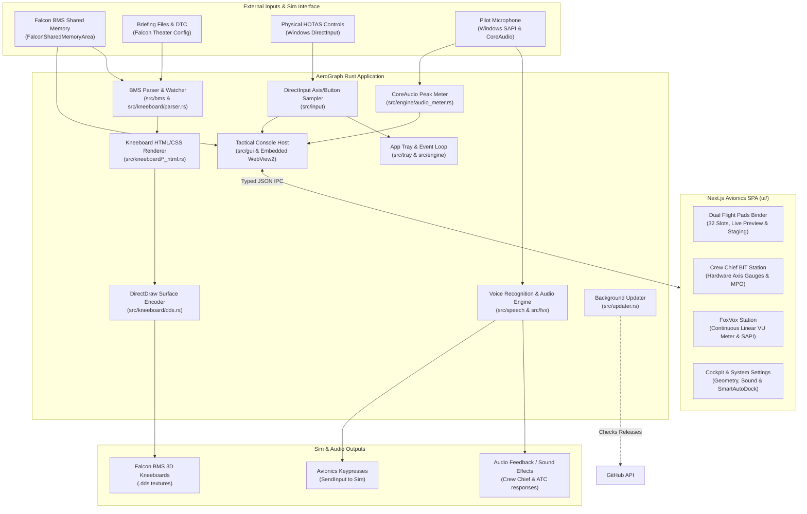

# AeroGraph Architecture & System Design

This document outlines the high-level architecture, subsystem boundaries, data flow, threading model, and UI integration of AeroGraph. It is designed to help maintainers and contributors understand how AeroGraph integrates with Falcon BMS, physical flight hardware, and Windows without needing to reverse-engineer individual source files.

---

## 1. System Overview

AeroGraph is a native, high-performance Windows desktop application built in Rust for the **Falcon BMS 4.38** flight simulator. It serves three primary operational roles:

1. **Automated Cockpit Kneeboard Generation**: Reads Falcon BMS shared memory, theater configuration, and briefing/DTC files to dynamically generate high-resolution, vector-quality kneeboard pages (departure, arrival ILS plates, steerpoints, threats, roster, POH notes) and compile them directly into DirectDraw Surface (`.dds`) textures in the pilot's 3D cockpit.
2. **Authentic Voice & Avionics Integration**: Natively executes FoxVox voice profiles (`.fvx`) using Windows SAPI (Speech API) to provide realistic voice interaction with the Crew Chief (ramp start sequences), ATC, AWACS, Tanker, JTAC, and cockpit avionics switches with Bogey Dope audio feedback.
3. **Tactical Avionics Console (GUI)**: An embedded, hardware-accelerated avionics workstation providing real-time dual kneepad staging (`1L`–`16L`, `1R`–`16R`), markdown notes editing, Quick Stamp insertion, Crew Chief hardware BIT monitoring, and FoxVox speech diagnostics.

---

## 2. High-Level Subsystem Map

---

## 3. Subsystem Breakdown

### `src/bms/`: Sim State & Theater Integration
- **`shared_memory.rs`**: Interfaces with Windows shared memory (`OpenFileMappingW` / `MapViewOfFile`) to read real-time telemetry from the running Falcon BMS instance (`FlightData`, radio frequencies, steerpoints, bullseye vectors, and 3D flight status).
- **`config_parser.rs`**: Resolves Falcon BMS installation paths, active theater directories (e.g. Korea, Balkans), and DTC profiles from the Windows registry and configuration files.

### `src/kneeboard/`: Kneeboard Generation & DDS Pipeline
- **`parser.rs`**: Parses raw Falcon BMS mission briefing text files, extracting flight plans, steerpoints, threat envelopes, PPTs, Link 16 network assignments, and package rosters.
- **`*_html.rs` & `*_render.rs`**: Generates high-contrast, cockpit-optimized HTML/CSS layouts for:
  - Departure and arrival airport diagrams with active runway detection
  - ILS instrument approach plates
  - Steerpoint flight data and threat radar envelopes
  - Package pilot rosters and T.O. 1F-16 POH flight notes
- **`crop.rs` & `runways.rs`**: Calculates geographic bounds and vector projections for airport taxiways, runways, and threat rings.
- **`dds.rs`**: Encodes rasterized page images into DirectDraw Surface (`.dds`) format conforming to the exact dimensions, color formats, and mipmap layouts required by Falcon BMS cockpit texture managers (`7982.dds` through `7997.dds`).
- **`watcher.rs`**: Monitors theater folders and briefing updates to trigger automatic, real-time kneeboard regeneration when mission state changes.

### `src/speech/` & `src/fvx/`: Voice Recognition & FoxVox Engine
- **`sapi.rs`**: Interfaces with the Windows Speech API (SAPI) to build low-latency grammar trees from voice profile definitions.
- **`loader.rs` & `models.rs`**: Parses `.fvx` profiles directly in Rust without external runtime dependencies.
- Translates pilot voice calls (Crew Chief ramp startup sequences, ATC departures, AWACS threat calls, radio channel pushes) into simulated cockpit keypresses and authentic audio playback.

### `src/input/`: HOTAS & Controller Sampling
- **`direct_input.rs` & `axis_sampler.rs`**: Captures hardware events from connected flight controllers (joysticks, throttles, rudder pedals) via DirectInput at up to 100 Hz, allowing physical button bindings and flight control BIT validation.

### `src/engine/` & `src/tray/`: Application Shell, State & Audio Metering
- **`app_tray.rs`**: Implements the native Windows system tray icon, notification menus, audio mute controls, profile browsing, and setup dialogues.
- **`audio_meter.rs`**: Implements a dedicated Windows CoreAudio (`IAudioClient` and `IAudioMeterInformation`) peak sampler operating in `AUDCLNT_SHAREMODE_SHARED`.
  - Samples at ~50 Hz to drive the live VU-meter and top-chassis visualizer.
  - **Complete Hardware Dormancy**: Automatically stops the audio capture stream, drops COM endpoint references, and sleeps whenever the Tactical Console is closed or Voice Recognition is disabled, consuming zero background CPU.
- **`state.rs` & `audio.rs`**: Manages global application state, thread synchronization, and sound effect playback.
- **`updater.rs`**: Background thread that checks `GET /repos/yagiziskirik/AeroGraph/releases/latest` on launch to notify pilots when an update is available.

### `src/gui/` & `ui/`: Tactical Console Subsystem
- **Rust Host (`src/gui/`)**:
  - **`window.rs`**: Manages the frameless, dark avionics window using `tao` and embedded Microsoft Edge WebView2 (`wry = "0.47"`).
  - **`assets.rs`**: Statically embeds compiled Next.js assets (`ui/out/`) at compile-time via `rust-embed` with zero external web server requirement.
  - **`ipc.rs`**: High-performance, typed JSON IPC protocol bridging the Rust event loop and Next.js DOM:
    - `IpcRequest`: Window controls, geometry queries, profile selection, listening toggle, slot updates, and manual kneeboard regeneration.
    - `TelemetryData`: 25 Hz sim telemetry stream (3D flight, BMS connection, callsign, steerpoints, frequencies, pitch/roll/yaw, dual brakes, MPO, and audio peak level).
    - `AudioLevel`: High-frequency audio level broadcasts for smooth visualizer animation.
  - **Geometry Persistence**: Automatically persists and restores window position (`window_x`, `window_y`), dimensions (`window_width`, `window_height`), and maximized state across application restarts in `AppConfig`.
  - **Zero-Footprint Lifecycle (`SmartAutoDock`)**: Completely tears down the WebView2 instance and window when closed or during 3D flight, freeing 100% of GPU and CPU memory for the simulator.
- **Next.js Frontend (`ui/`)**:
  - Static export SPA built with React 18, Next.js 14, Tailwind CSS, and Framer Motion.
  - **Cockpit Binder Station**:
    - Dual kneepad stations (`1L`–`16L`, `1R`–`16R`; 32 slots total) centered strictly around `kneeboards.json`.
    - Safe in-memory staging: changes are kept staged in memory until explicitly committed via **Commit to Cockpit**, preserving custom templates and formatting.
    - Authentic live HTML/CSS render engine and markdown editor with coordinate-safe edge-to-edge zoom controls (Fit, 1:1, zoom in/out).
    - 16-page orbital Radial Dial popover rendered via React Portal overlaying station headers.
    - Quick Stamps engine (`BINGO`, `LASER`, `RAMROD`, `ROE`, `SAM THREAT`, `IP VECTOR`) and customizable user templates with persistent localStorage storage.
  - **Crew Chief BIT Station**: Live flight control hardware gauges (Pitch, Roll, Yaw, Dual Independent Wheel Brakes, MPO switch, PTT status, active buttons) with Framer Motion spring physics.
  - **FoxVox Comms Station**:
    - Active profile management and live SAPI speech recognition transcript.
    - Continuous linear VU meter with calibrated decibel scale ($-45\text{ dBFS}$ to $0\text{ dBFS}$), peak-hold needle indicator, and silence noise gate.
  - **Cockpit & Settings Station**: UI accent color customization, audio volume slider, auto-dock preferences, and polling rate tuning.
  - **Top Chassis Grip Bar**: Custom frameless title bar with official AeroGraph insignia, sim connection status, 16-bar voice mixer equalizer, and window controls.

---

## 4. Architectural Stability Guidelines

To minimize maintenance overhead, this document focuses on **subsystem responsibilities and system boundaries** rather than internal function signatures.

> [!TIP]
> **When does this document need an update?**
> - When a **new subsystem** is introduced (e.g., a new protocol, network sync, or export format).
> - When an **external dependency or integration** is fundamentally changed (e.g., changing texture rasterization or sim communication methods).
> - Internal refactorings, algorithm optimizations, and new kneeboard page templates do **not** require updating this file.
