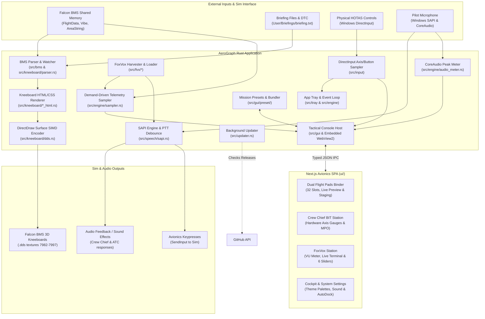

# AeroGraph Architecture & System Design

This document outlines the high-level architecture, subsystem boundaries, data flow, threading model, and UI integration of AeroGraph. It is designed to help maintainers and contributors understand how AeroGraph integrates with Falcon BMS, physical flight hardware, and Windows without needing to reverse-engineer individual source files.

---

## 1. System Overview

AeroGraph is a native, high-performance Windows desktop application built in Rust for the **Falcon BMS 4.38** flight simulator. It serves three primary operational roles:

1. **Automated Cockpit Kneeboard Generation**: Reads Falcon BMS shared memory, theater configuration, and briefing/DTC files to dynamically generate high-resolution, vector-quality kneeboard pages (departure/arrival taxi charts, ILS plates, steerpoint routes, threat rings, package rosters, and T.O. 1F-16 POH notes) and compile them directly into DirectDraw Surface (`.dds`) textures in the pilot's 3D cockpit (`7982.dds` through `7997.dds`).
2. **Authentic Voice & Avionics Integration**: Natively executes FoxVox voice profiles (`.fvx`) using Windows SAPI (Speech API) to provide realistic voice interaction with the Crew Chief (ramp start sequences), ATC, AWACS, Tanker, and wingmen, backed by DirectInput HOTAS hardware sampling, demand-driven telemetry polling, and acoustic feedback.
3. **Tactical Avionics Console (TAC)**: An embedded, hardware-accelerated avionics workstation providing dual kneepad staging (`1L`–`16L`, `1R`–`16R`), live Markdown notes editing, Quick Stamp insertion, Crew Chief hardware BIT diagnostics, and FoxVox speech calibration.

---

## 2. High-Level Subsystem Map

---

## 3. Subsystem Breakdown

### `src/bms/`: Sim State & Theater Integration
- **`shared_memory.rs`**: Interfaces with Windows memory-mapped files (`OpenFileMappingW` / `MapViewOfFile`) to read real-time telemetry from Falcon BMS:
  - `FalconSharedMemoryArea`: Primary flight data (`PrimaryFlightData`), HSI flags, radio frequencies, steerpoints, and bullseye vectors.
  - `FalconIntellivibeSharedMemoryArea`: Vibration data (`IntellivibeData`), G-forces, on-ground status (`is_on_ground`), and 3D flight indicator (`in_3d`).
  - `FalconSharedMemoryAreaString`: Multi-string payload decoding. Reads the 12-byte header (`VersionNum`, `NoOfStrings`, `dataSize`) and extracts null-terminated strings:
    - String ID 29 (`AcName`): Active aircraft type.
    - String ID 35 (`VoiceHelpers`): High-density flight roster string formatted as `<player>|<seats>,<tanker>,<awacs>,<departure>,<arrival>,<alternate>`. Decodes package size, seat allocations (`AISeat1`–`AISeat4`), active Tanker callsign, AWACS agency, and theater airfields.
- **`config_parser.rs`**: Resolves Falcon BMS installation paths, active theater directories (e.g. Korea, Balkans), and DTC profiles from the Windows registry and configuration files without hardcoded paths.

### `src/engine/`: Telemetry Sampling & Application Core
- **`sampler.rs`**: **Demand-Driven Variable Sampling Engine (`BmsSubscriptionPlan`)**:
  - Compiles an optimized, zero-allocation sampling plan based strictly on the telemetry variables demanded by the active `.fvx` profile.
  - Bypasses unneeded shared memory regions to minimize CPU overhead.
  - Permanently subscribes mandatory internal variables (`In3D`, `OnGround`) regardless of profile contents to guarantee simulation safety.
- **`audio_meter.rs`**: Dedicated Windows CoreAudio (`IAudioClient` and `IAudioMeterInformation`) peak sampler operating in `AUDCLNT_SHAREMODE_SHARED`:
  - Continuously calculates perceptual logarithmic dBFS levels ($-45\text{ dBFS}$ to $0\text{ dBFS}$) at ~50 Hz.
  - **Hardware Dormancy**: Automatically releases audio endpoints, drops COM interface references, and enters zero-CPU sleep when the Tactical Console is closed or voice recognition is muted.
- **`state.rs` & `audio.rs`**: Manages dynamic profile state, variable condition evaluation (`ConditionGroup`, `VariableCondition`), and synchronous/asynchronous sound playback.
- **`updater.rs`**: Flight-safe background updater that queries GitHub Releases on startup without interrupting active 3D flights.

### `src/fvx/`: FoxVox Profile & Variable Harvesting
- **`loader.rs` & `models.rs`**: Full Rust XML deserializer for FoxVox `.fvx` profiles without external runtime dependencies. Translates commands, groups, phrases, and key macros into memory.
- **`harvester.rs`**: **Profile Variable Harvester**:
  - Analyzes profile condition gates, variable initializers (`VariableInits`), and update actions (`VariableUpdates`).
  - Automatically derives the complete set of required telemetry variables for the sampling engine, eliminating inactive condition gate errors.

### `src/speech/`: SAPI Engine & Push-To-Talk Timings
- **`sapi.rs`**: Native Windows Speech API (SAPI) COM wrapper:
  - Compiles `.fvx` phrases into a compacted 2-stage hierarchical prefix-tree grammar, reducing SAPI graph transitions by ~97% and loading binary caches in $< 2\text{ ms}$.
  - Configures native COM engine properties via `ISpRecognizer::SetPropertyNum`:
    - `EndSilenceTimeout`: Silence duration required before triggering an unambiguous command.
    - `EndSilenceTimeoutAmbiguous`: Extended silence required when multiple grammar phrases could potentially match.
    - `InitialSilenceTimeout`: Maximum wait time for speech after PTT activation before the listening window closes.
  - Implements `set_silence_timeouts()` for live runtime reconfiguration without destroying COM recognizer instances.
- **Main Worker Loop (`src/main.rs`)**:
  - **PTT Debounce Gate**: Measures COM1 (UHF) and COM2 (VHF) press start timestamps; presses shorter than `min_ptt_duration_ms` (default 300 ms) are rejected as transient switch bounces.
  - **Post-Release Grace Window**: Maintains an audio buffer for `ptt_release_grace_ms` (default 1500 ms) so pilot speech isn't cut off on the trailing syllable.
  - **Dynamic Confidence Floor**: Filters recognitions against configurable `min_confidence` (default 50%).
  - **Standby Deduplication**: Suppresses redundant acknowledgment audio when *"stand by"* is spoken while already muted.

### `src/kneeboard/`: Kneeboard Generation & DDS Pipeline
- **`parser.rs`**: Real-time briefing parser extracting package rosters, steerpoint routes, SAM threat envelopes, PPTs, Link 16 network assignments, and weather reports from `briefing.txt`.
- **`*_html.rs` & `*_render.rs`**: Renders high-contrast, daylight-tinted (`#FAFAF8`) 1024×1554 HTML/CSS cards:
  - Departure and arrival vector taxi diagrams with live wind calculations and active runway detection.
  - ILS instrument approach plates.
  - 16k SkyVector theater maps with flight polylines and SAM threat rings.
  - T.O. 1F-16 POH custom notes with asymmetric title notch, clip-clearing hazard stripes, callout blockquotes (`> Note`), embedded graphics (``), inline bold/italic typography, and syntax escaping (`\:`).
- **`dds.rs`**: Batches Left and Right page pairs into 2048×2048 textures and executes multi-threaded SIMD BC1/DXT1 compression across all CPU cores in parallel ($< 1.5\text{ s}$ total generation time).
- **`watcher.rs`**: Low-latency file watcher on `User/Briefings/briefing.txt` with audible generation chimes.

### `src/gui/` & `ui/`: Tactical Avionics Console Subsystem
- **Rust Host (`src/gui/`)**:
  - **`window.rs`**: Manages the borderless dark avionics window using `tao` and embedded Microsoft Edge WebView2 (`wry = "0.47"`).
  - **`assets.rs`**: Embeds compiled Next.js static assets (`ui/out/`) directly into the executable via `rust-embed`.
  - **`ipc.rs`**: Typed JSON IPC bridge handling window controls, telemetry streaming (25 Hz), CoreAudio levels, profile reloading, and config synchronization.
  - **`preset/`**: Standalone mission preset bundles (`.aeropreset`). Gzip-compresses 32-slot configurations, custom notes, HTML templates, and user images with base64 encoding and byte-level deduplication on import.
  - **`SmartAutoDock`**: Automatically closes and tears down the WebView2 instance upon entering Falcon BMS 3D flight, freeing 100% of GPU and memory resources for the simulator.
- **Next.js Frontend (`ui/`)**:
  - **`BinderView`**: Dual kneepad stations (`1L`–`16L`, `1R`–`16R`) with in-memory staging, orbital radial dial jumps, Alt + Scroll wheel page flipping, and live Markdown editor.
  - **`BitView`**: Crew Chief BIT station with live DirectInput flight control surface gauges (Pitch, Roll, Yaw), differential toe brakes with one-click axis inversion toggle, and HOTAS switch diagnostics.
  - **`CommsView`**: FoxVox Communications Station:
    - Master voice recognition toggle, standby mute control, profile manager, and pilot voice selector.
    - Continuous linear VU-meter ($-45\text{ dBFS}$ to $0\text{ dBFS}$) and live speech recognition terminal.
    - **SAPI & PTT Calibration Station**: $3 \times 2$ grid with 6 interactive sliders (Confidence Floor, PTT Min Hold, PTT Release Grace, End Silence, Ambiguous Silence, Initial Silence Timeout) featuring per-slider factory resets (`↺`), dirty state tracking, and live IPC configuration persistence.
  - **`SystemView`**: Avionics luminescence color themes (8 HUD palettes), mechanical acoustic relays, and simulation automation options.

---

## 4. Architectural Stability Guidelines

To minimize maintenance overhead, this document focuses on **subsystem responsibilities and system boundaries** rather than internal function signatures.

> [!TIP]
> **When does this document need an update?**
> - When a **new subsystem** is introduced (e.g., a new protocol, network sync, or export format).
> - When an **external dependency or integration** is fundamentally changed (e.g., changing texture rasterization or sim communication methods).
> - Internal refactorings, algorithm optimizations, and new kneeboard page templates do **not** require updating this file.
